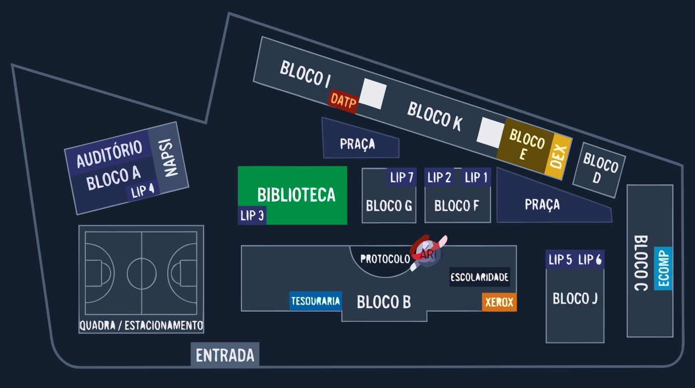

# 📍 Mapa Acessível POLI

Uma aplicação web interativa de navegação indoor desenvolvida para a **Escola Politécnica (POLI)**. O sistema utiliza a biblioteca **Leaflet.js** adaptada para coordenadas planas em conjunto com um algoritmo de busca em grafo (BFS) para traçar rotas acessíveis e realistas através dos corredores do campus.



---

## ✨ Funcionalidades

- 🌙 **Interface Dark Mode & Alto Contraste:** Design moderno focado em acessibilidade visual, utilizando paleta escura (`#0f172a`), marcadores em ciano (`#38bdf8`) e linha de rota em amarelo vibrante (`#facc15`).
- 📲 **Localização Dinâmica via QR Code:** Leitura de parâmetros diretamente da URL (`?origem=bloco_a`) para identificar automaticamente em qual bloco o utilizador se encontra.
- 🛣️ **Navegação Inteligente por Corredores:** Algoritmo de roteamento baseado em grafos que garante que o caminho traçado siga os corredores e pátios, evitando linhas retas que atravessam edifícios.
- 🎯 **Marcadores Interativos:** Popups interativos em todos os blocos com o botão *"Traçar Rota para cá"*, permitindo selecionar destinos diretamente no mapa.
- 📱 **Design Responsivo:** Adaptado para navegação fluida em dispositivos móveis e desktops.

---

## 🛠️ Tecnologias Utilizadas

- **HTML5 & CSS3:** Estruturação semântica e estilização customizada com variáveis de acessibilidade.
- **JavaScript (ES6+):** Lógica do algoritmo de rotas e manipulação de eventos do DOM.
- **[Leaflet.js](https://leafletjs.com/):** Biblioteca para renderização do mapa interativo utilizando o sistema de coordenadas `L.CRS.Simple`.
- **Recraft.ai:** Geração e vetorização da planta baixa em alta resolução com estética Dark Mode.

---

## 📁 Estrutura do Projeto

```text
Mapa_Acessivel_Poli/
├── assets/
│   └── Planta_Poli.png       # Planta do campus em alta resolução (Dark Mode)
├── css/
│   └── style.css             # Estilos do tema, componentes e popups
├── js/
│   └── mapa.js               # Lógica do Leaflet, coordenadas, grafo e BFS
├── index.html                # Estrutura principal da aplicação
└── README.md                 # Documentação do repositório